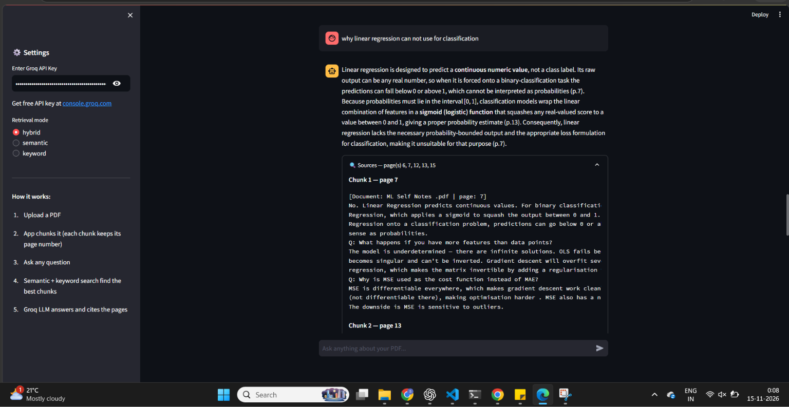

# 📄 Chat with PDF — Hybrid RAG with Page Citations

Upload a PDF and ask questions about it. Retrieval combines semantic search (ChromaDB embeddings) with BM25 keyword search, and every answer cites the page(s) it came from.

## 🚀 Live Demo
[Click here to try it](YOUR_STREAMLIT_LINK_HERE)

## 📸 Screenshot


---

## 🧠 How It Works

PDF upload
→ Extract text page by page (pypdf), keeping the page number
→ Split into chunks (RecursiveCharacterTextSplitter)
→ Add a contextual header to each chunk: [Document: name.pdf | Page: N]
→ Index two ways:
     • dense: all-MiniLM-L6-v2 embeddings in ChromaDB
     • sparse: BM25 keyword index (rank-bm25)
→ User asks a question
→ Both indexes return their top candidates
→ Merge the two rankings with Reciprocal Rank Fusion (RRF)
→ Send the top chunks + question to Groq (GPT-OSS 20B)
→ Answer cites pages, e.g. "(p.2)", and the sources are shown under the answer

Why hybrid?
1. Semantic search finds passages that mean the same thing as the question, even with different words.
2. BM25 finds exact terms (names, numbers, codes, tool names) that embeddings can blur.
3. RRF merges the two lists using rank positions, because BM25 scores and cosine distances are on different scales and cannot be added directly.

---

## ⚙️ Tech Stack

| Component | Technology |
|---|---|
| UI | Streamlit |
| RAG Framework | LangChain |
| Embeddings | sentence-transformers (all-MiniLM-L6-v2) |
| Vector Database | ChromaDB |
| Keyword search | rank-bm25 (BM25Okapi) |
| Rank fusion | Reciprocal Rank Fusion (k = 60) |
| LLM | Groq (GPT-OSS 20B) |
| PDF Reader | pypdf |
| Text Splitter | RecursiveCharacterTextSplitter |

---

## ✨ Features

- Hybrid retrieval with a sidebar switch: hybrid, semantic or keyword
- Page-level citations in every answer
- "Sources" panel under each answer showing the exact chunks and page numbers used
- Answers restricted to the document, with a fallback of "I don't know based on the provided document" (this reduces, but does not eliminate, hallucination)
- Conversation history within a session
- Index is built once per uploaded file, not on every message

---

## 🏃 Run Locally

**Clone the repo:**
```bash
git clone https://github.com/Shaheen3107/Chat-with-PDF---RAG-Application.git
cd Chat-with-PDF---RAG-Application
```

**Create virtual environment:**
```bash
python -m venv venv
venv\Scripts\activate  # Windows
source venv/bin/activate  # Mac/Linux
```

**Install dependencies:**
```bash
pip install -r requirements.txt
```

**Run the app:**
```bash
python -m streamlit run app.py
```

**Get your free Groq API key:**
- Go to [console.groq.com](https://console.groq.com)
- Sign up free
- Copy your API key
- Paste in the app sidebar

---

## 📁 Project Structure

```
├── app.py            # Streamlit UI only (sidebar, upload, chat screen)
├── rag_core.py       # Full RAG pipeline: PDF, chunking, embeddings, ChromaDB, BM25, LLM, chain
├── requirements.txt
├── README.md
└── screenshot.png    # App screenshot
```

---

## 💡 Key Concepts Demonstrated

- **RAG pipeline** — ingestion, retrieval, grounded generation
- PDF text extraction with pypdf, page by page
- Chunking with overlap and metadata (page numbers) carried through to the answer
- Contextual chunk headers
- Semantic embeddings: converting text to vectors with sentence-transformers
- Vector database: storing and searching embeddings with ChromaDB
- Dense vs sparse retrieval (cosine similarity search and BM25), and why combining them helps
- Reciprocal Rank Fusion
- Prompting for citations and for refusing when the context lacks the answer
- Hallucination reduction: answers only from retrieved document context

---

## 👤 Author

**Shaheen Akram**
- GitHub: [@Shaheen3107](https://github.com/Shaheen3107)

---

## 📝 Related Projects

- [ATS Resume Checker](https://github.com/Shaheen3107/ATS-Resume-Checker)
- [Fake News Detector](https://github.com/Shaheen3107/fake-news-detector) 
